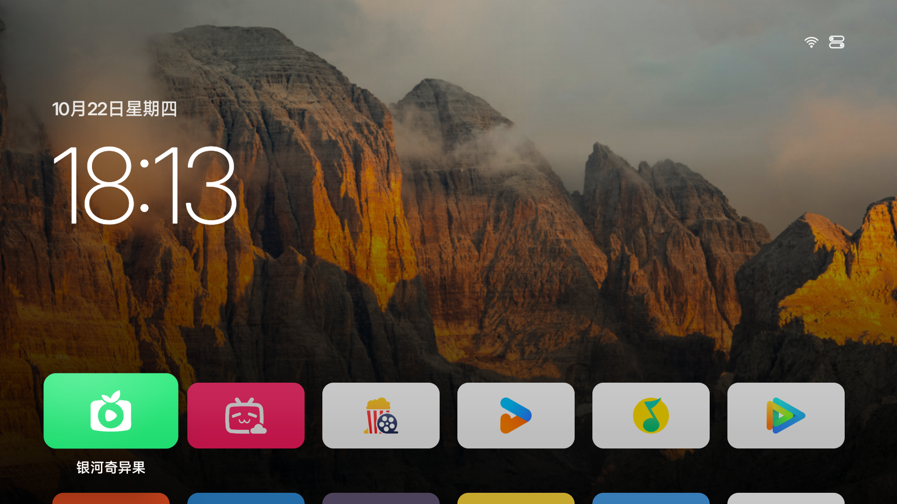
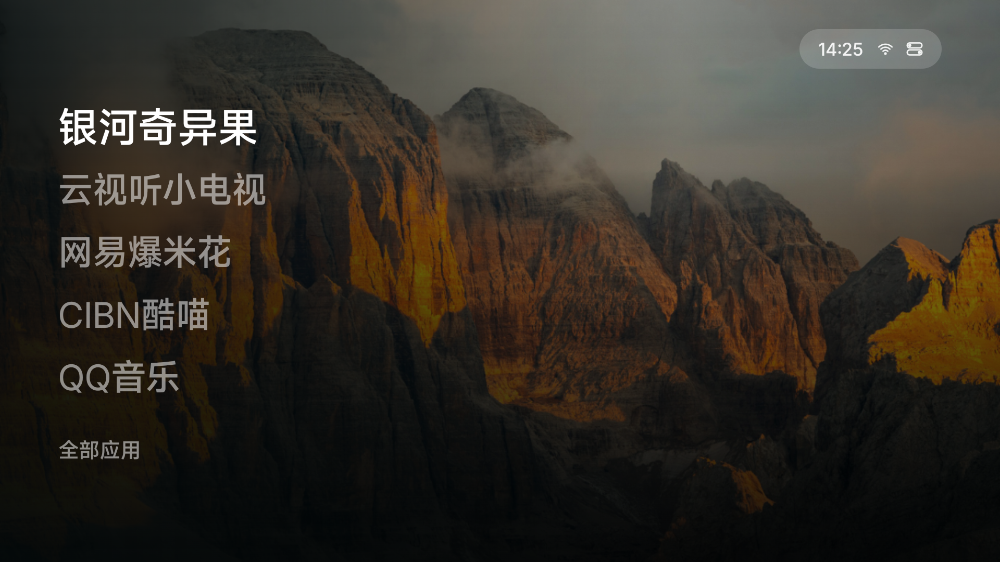
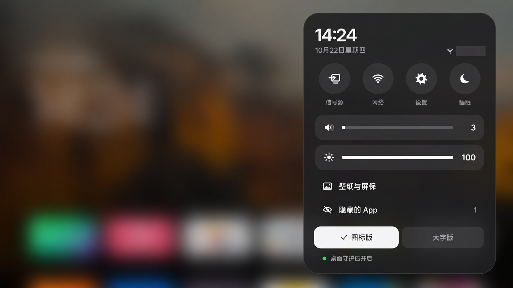
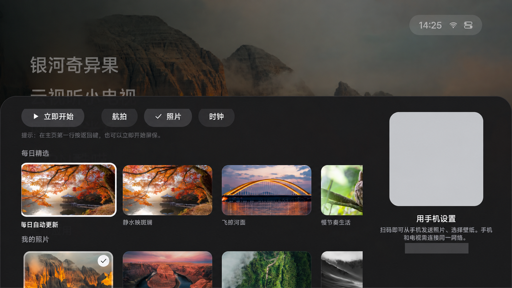

# wuji-tv

**两种风格，一屏风景。**

基于 [Aerial](https://github.com/pengchujin/aerial-tv) 修改的 Android TV 桌面。在同一个应用里切换「图标版」与「大字版」，共用壁纸、照片和应用排序。

[下载安装包](https://github.com/aaron85517/wuji-tv/releases/tag/v0.2.0) · [完整使用说明](docs/USAGE.zh-CN.md) · [验证记录](docs/VALIDATION.md) · [反馈问题](https://github.com/aaron85517/wuji-tv/issues)

> 首个分享版本主要在小米电视 S Pro Mini LED 85 英寸（2025 款）上使用。其他电视、固件的兼容性尚未验证。安装不需要 root，不需要卸载或停用系统桌面。

## 界面预览

下面两张是同一台电视、同一张壁纸的实际截图。显示的应用来自使用者自己的安装与排序，每台电视可以不同。

| 图标版 | 大字版 |
|:---:|:---:|
|  |  |

### 风格切换与快捷设置

按遥控器菜单键，或选择右上角快捷入口，在控制中心底部直接选择「图标版 / 大字版」。勾选标记表示当前风格，白色按钮表示遥控器当前焦点。



### 壁纸、屏保与手机上传

进入「壁纸与屏保」，选择每日精选、自己的照片及屏保模式。手机连接同一局域网后，扫描电视上实际显示的二维码即可上传图片。



两张首页图为直接截图；设置图基于真机截图，经图片编辑工具遮挡 Wi-Fi 名称、二维码和地址，画面有缩放。请扫描自己电视上的二维码，文档图片不能用于连接。

## 本次更新 · v0.2.0

新增可选天气：用自己的和风天气 API Host 与 API Key 配置。**不配置就不显示天气，不提示错误，也不发起天气请求**；关闭天气或清除 Key 后，旧缓存也会隐藏。

图标版在大时间旁显示天气图标与温度；大字版显示在右上角快捷入口。取得天气后，控制中心第一排增加天气圆形按钮，点击可打开本机小米天气。没有天气数据时保持原来的四个按钮。

配置入口在「壁纸与屏保 → 手机扫码页 → 天气（可选）」，包含申请和填写指引。详见 [天气配置说明](docs/WEATHER.md) 与 [更新记录](CHANGELOG.md)。公开源码与安装包不包含维护者的天气凭据。

## 有什么不同

| 功能 | 使用方式 |
|---|---|
| 图标版 | 六列应用网格，底部首排完整、下一排露边；没有半透明底板，保留左上大时间；选中磁贴放大、浮起，无额外白色描边 |
| 定制应用图标 | 26 个应用使用重绘卡片；其他应用使用原图标与通用底色 |
| 大字版 | 左侧显示排序后的前五个可见应用，下面是固定的「全部应用」入口 |
| 大字选中效果 | 文字放大、加粗、变亮，没有阴影、边框或背景底板 |
| 随时切换 | 打开右上角控制中心，在底部直接选择「图标版」或「大字版」 |
| 自定义排序 | 在应用网格长按确认键 →「排序」→ 用方向键移动 → 确认放下 |
| 共用壁纸 | 两个风格使用同一套壁纸、上传照片和屏保设置 |
| 手机上传照片 | 控制中心 →「壁纸与屏保」→ 手机扫描右侧二维码 |
| 可选天气 | 自行配置和风天气；图标与温度、控制中心天气按钮；未配置时完全隐藏 |
| 快捷功能 | 信号源、网络、系统设置、睡眠、音量与亮度，具体能力取决于电视固件 |

大字版不固定爱奇艺、哔哩哔哩等名称。你把哪些应用排在前五位，它就显示哪些；隐藏的应用不占名额。大字版右上角并排显示时间、网络状态与快捷入口。

继承自 Aerial 的功能包括每日壁纸、渐变背景、照片壁纸、航拍/照片/时钟屏保。航拍视频与每日精选需要网络，应用内不包含视频服务会员或付费内容。

## 下载与安装

到 [v0.2.0 发布页](https://github.com/aaron85517/wuji-tv/releases/tag/v0.2.0) 下载 **`wuji-tv-v0.2.0.apk`**。不要下载 GitHub 自动生成的 Source code 压缩包来安装。

当前公开安装包的信息：

| 项目 | 当前值 |
|---|---|
| 电视中显示的应用名 | Aerial 焦点增强版 / Aerial Focus |
| 应用包名 | `app.orchard.tv.focus` |
| APK 内部版本 | `1.8-focus.8`，versionCode `17` |
| GitHub 分享版本 | `v0.2.0` |
| Android 最低版本 | Android 8.0（不代表所有该版本以上电视均已适配） |

保留现有应用名称与包名是为了延续已安装版本的数据和覆盖升级。wuji-tv 与上游 `app.orchard.tv` 是两个应用；请避免同时启用两套桌面守护。

### 1. 准备电视

电脑与电视连接同一局域网。记录电视 IP；在小米电视「设置 → 账号与安全」打开 **ADB 调试** 与 **安装未知来源的应用**。不同固件入口可能不同。

电脑安装 Google 官方 [Android SDK Platform-Tools](https://developer.android.com/tools/releases/platform-tools)，在终端使用其中的 `adb`。Windows 可以在该目录打开 PowerShell，并把下文的 `adb` 改成 `./adb.exe`。

### 2. 安装并试用

把 `<电视IP>` 换成电视的实际 IP；在下载的 APK 所在目录执行：

```bash
adb connect <电视IP>:5555
adb -s <电视IP>:5555 install -r wuji-tv-v0.2.0.apk
adb -s <电视IP>:5555 shell cmd package compile -m speed -f app.orchard.tv.focus
adb -s <电视IP>:5555 shell am start -n app.orchard.tv.focus/app.orchard.tv.MainActivity
```

首次连接时，在电视弹窗中选择「允许 USB 调试」。此时先检查显示、方向键和应用启动是否正常；普通试用不需要开启桌面守护。

### 3. 让主页键与开机进入桌面

确认愿意使用后，再执行以下授权。它们用于恢复桌面守护、允许后台打开桌面和待机后恢复；不会停用小米系统桌面。

```bash
adb -s <电视IP>:5555 shell pm grant app.orchard.tv.focus android.permission.WRITE_SECURE_SETTINGS
adb -s <电视IP>:5555 shell appops set app.orchard.tv.focus SYSTEM_ALERT_WINDOW allow
adb -s <电视IP>:5555 shell cmd notification allow_listener app.orchard.tv.focus/app.orchard.tv.guard.RevivalListener
adb -s <电视IP>:5555 shell am start -n app.orchard.tv.focus/app.orchard.tv.MainActivity
```

启动后，应用会在保留其他无障碍服务的前提下启用自己的守护。在控制中心查看「桌面守护已开启」。用遥控器打开一个应用，再按主页键检查返回；保存当前内容后，可自行重启电视验证开机效果。

本版本已移除全局方向键过滤；主页返回通过监听系统桌面窗口处理，部分情况下会短暂看到原桌面。**不要停用 `com.mitv.tvhome`，也不要照搬原版拦截按键的配置。**

亮度、Wi-Fi 名称读取等可选权限，以及保持 ADB 的设置，见 [完整说明](docs/USAGE.zh-CN.md)。

> 仓库中的 `tools/get.sh`、`tools/install.sh`、`tools/restore.sh` 是上游工具，仍使用原版包名及下载地址，不能用于安装或还原本分享版。当前版本请使用本页步骤。

## 日常怎么用

- **切换风格**：按遥控器菜单键，或选择右上角快捷入口，进入控制中心，在底部选择「图标版 / 大字版」。
- **调整前五个应用**：大字版进入「全部应用」，长按目标应用的确认键，选「排序」，方向键移动，确认键放下。调整结果同步到两种风格。
- **换壁纸**：控制中心 →「壁纸与屏保」。两个风格共享选择，无需分别上传。
- **上传图片**：手机与电视连接同一局域网，扫描面板右侧二维码，在网页上传或选择图片。优先用横向照片；电视画面为 16:9。
- **配置天气（可选）**：打开「壁纸与屏保」，手机扫码，在网页的「天气（可选）」中按说明填写自己的 API Host、API Key 并开启。每小时最多尝试一次；本机每月最多 50,000 次，达到后停止。该计数不能代替和风账号总配额，详见 [天气说明](docs/WEATHER.md)。
- **恢复隐藏应用**：控制中心 →「隐藏的 App」。
- **打开系统设置**：控制中心上方的「设置」。

方向键、长按菜单、返回与屏保行为见 [完整说明](docs/USAGE.zh-CN.md)。

## 停止接管，回到原桌面

在电视系统设置中先选择原系统桌面（如果有此选项）。再用电脑执行：

```bash
adb -s <电视IP>:5555 shell pm disable-user --user 0 app.orchard.tv.focus
adb -s <电视IP>:5555 shell input keyevent KEYCODE_HOME
```

这只停用本项目的第三方应用，保留其数据，不会停用系统应用。重新使用时执行 `pm enable --user 0 app.orchard.tv.focus`，再按前面的步骤启动并检查授权。

也可以在停止接管后从系统应用管理中卸载「Aerial 焦点增强版」。**卸载会删除本应用上传的照片、排序与设置**，请先保存原图。完整授权撤销说明见 [使用说明](docs/USAGE.zh-CN.md#停止使用与恢复)。

## 适配与验证

小米 S Pro Mini LED 85 英寸（2025），机型 `MiTV-MFTR0`，Android 14，澎湃 OS `3.0.101.0.UFTMATV`：

- 真机检查过大字显示、应用网格、长按排序、前五项同步、共享壁纸及手机二维码入口。
- 使用者已在 v0.1.0 验收实体遥控器与重启后自动进入桌面，反馈正常；v0.1.1 的布局更新检查了方向键导航和风格切换，未再次重启。
- v0.1.2 已在同一台电视覆盖安装，确认新版图标正常显示，使用者反馈效果可以；本次未重复重启、排序或手机上传测试。
- v0.2.0 的个人版前身已在该机型验证天气获取与小米天气跳转；本次公开版增加未配置隐藏与自助配置，具体检查及尚未验证项见验证记录。
- 手机上传功能继承上游实现；本次确认入口与二维码，未重新上传照片测试。
- TCL、海信、索尼等其他机型未验证本分享版；上游机型笔记只能作为参考。

具体测试边界及已知限制见 [验证记录](docs/VALIDATION.md)。不承诺稳定 60fps，也不把编译通过等同于所有机型可用。

## 从源码构建

需要 JDK 17、Android SDK Platform 36；Gradle Wrapper 为 8.14.3。

```bash
git clone https://github.com/aaron85517/wuji-tv.git
cd wuji-tv
./gradlew :app:assembleFocusRelease
```

生成 APK：`app/build/outputs/apk/focus/release/app-focus-release.apk`。构建 **focus** flavor，才能得到本分享版包名；不要用 standard/guard APK 覆盖它。

发布 APK 使用维护者保管的本地签名；仓库不含密钥。自行构建时会回退到你电脑的 debug key，**不能直接覆盖官方分享版**。请自建独立签名并自行保管；不要为了测试而卸载已有应用，避免丢失照片和设置。

## 来源与许可

本项目基于 [pengchujin/aerial-tv](https://github.com/pengchujin/aerial-tv)，保留其 [MIT 许可与原作者署名](LICENSE)。公开的是当前定制源码快照；原版介绍见 [上游仓库](https://github.com/pengchujin/aerial-tv)。

界面方向参考大字列表桌面，包括 [guizang-tv](https://github.com/op7418/guizang-tv)；未将其壁纸打包进本项目。Inter 字体使用 [SIL Open Font License](FONT-LICENSE-OFL.txt)。航拍影片版权归 Apple，图片版权归各自作者；仓库不附带用户上传的照片或航拍视频。

应用图标中的品牌标识归各自权利人所有；本项目的图标适配不代表相关品牌授权或合作。

wuji-tv 为个人维护的开源修改版，与 Apple、小米及上述上游项目的维护者无官方关联。
