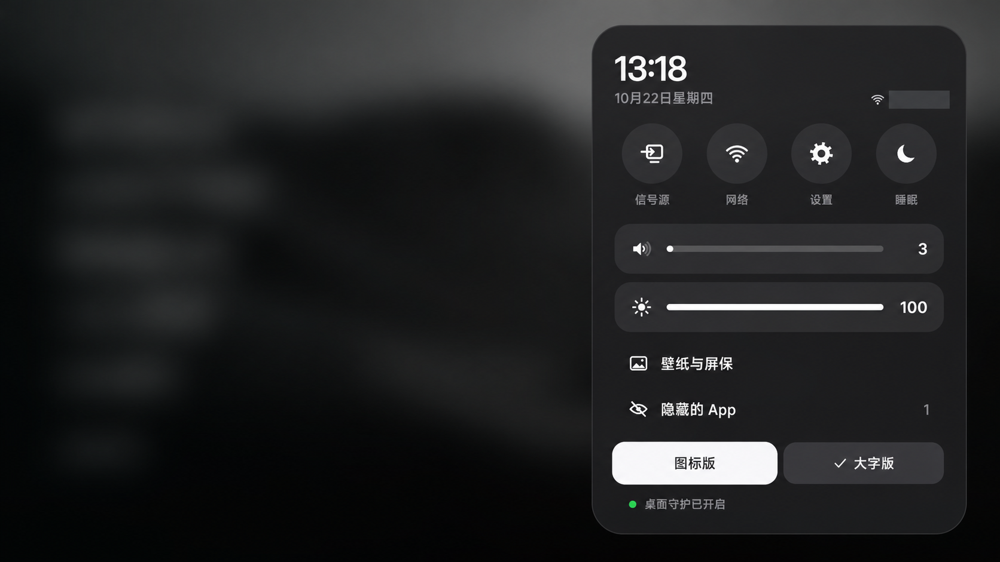
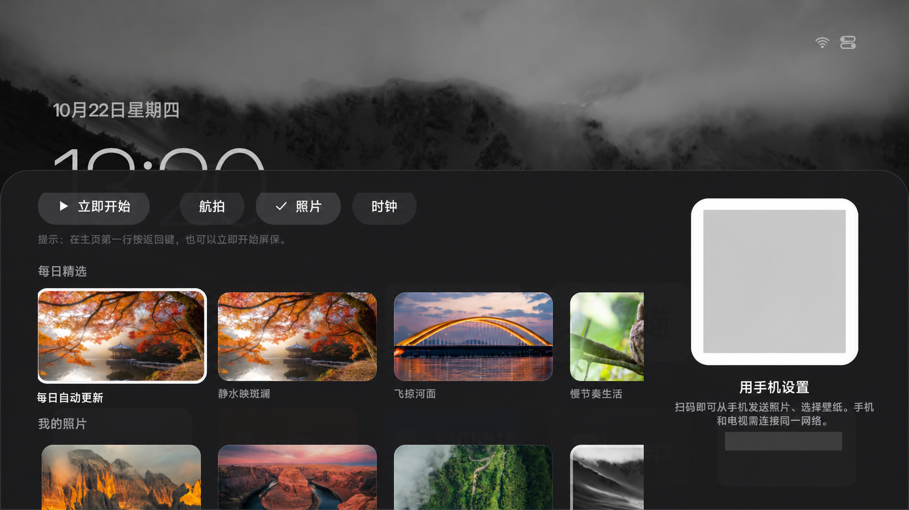

# wuji-tv 使用说明

适合第一次安装的朋友。请先阅读 [首页的下载与安装](../README.md#下载与安装)。当前电视里的应用名称仍为「Aerial 焦点增强版」。

## 安装前确认

1. 电视是 Android TV 系统；主要验证机型为小米 S Pro Mini LED 85 英寸（2025）。
2. 下载的是本仓库发布的 `wuji-tv-v0.1.0.apk`，而不是上游 standard/guard 版本。
3. 电脑与电视处于同一局域网，电视亮屏，ADB 调试已开启。
4. 现有的系统桌面、语音助手、投屏服务保持原样。如果已用其他第三方桌面，先处理它的接管设置，避免两个守护争抢主页。

### 常见连接提示

| 提示 | 处理 |
|---|---|
| `unauthorized` | 在电视上确认「允许 USB 调试」，必要时勾选始终允许 |
| `connection refused` / 超时 | 核对 IP，打开 ADB 调试，保持亮屏；必要时关闭再打开调试；不要通过关闭整个网络的安全防护排查 |
| 需要无线配对码 | 这是不同的无线调试流程，按该固件的配对页面与端口连接，不能假定固定为 5555 |
| `INSTALL_FAILED_UPDATE_INCOMPATIBLE` | 签名与已装版本不一致；先保留现有应用和数据，核对 APK 来源，不要直接卸载重装 |
| `INSTALL_FAILED_VERSION_DOWNGRADE` | 已装版本更新，不要强制降级；核对版本号 |
| `INSTALL_FAILED_VERIFICATION_FAILURE` | 固件安装策略限制，本分享版未在该机型验证；保留原桌面，先反馈完整错误 |

## 遥控器

| 位置 / 操作 | 效果 |
|---|---|
| 方向键 | 在当前页面的应用或控件间移动焦点 |
| 短按确认键 | 打开选中应用或入口 |
| 图标网格中长按确认键 | 打开应用菜单：排序、隐藏、应用信息、卸载等 |
| 大字版右方向键 | 从列表转到右上角快捷入口 |
| 菜单键 | 打开或关闭控制中心 |
| 主页键 | 已完成守护授权时返回本桌面；可能短暂经过系统桌面 |
| 大字版「全部应用」内按返回 | 关闭网格；排序时先退出排序 |
| 图标版滚动到后面时按返回 | 回到首页第一行 |
| 首页按返回 | 可触发屏保；这不等于退出应用 |
| 屏保左右键 | 航拍模式切换上一段 / 下一段；其他按键退出，时钟模式除外 |

按键布局因遥控器不同而异。没有菜单键时，从右上角快捷入口进入控制中心。

## 两种桌面风格

控制中心底部有「图标版」「大字版」两个按钮，当前风格带勾选标记。选择后返回对应桌面，风格偏好存储在应用内。



> 设置截图已遮挡网络名称等信息，按钮布局与操作请以电视上的实际界面为准。

图标版使用五列应用网格；选中磁贴浮起、放大并显示名称。大字版用左侧大字列表，选中项放大约 15%、加粗、变亮；时间和快捷入口放在右上角。

两者共用壁纸、照片、排序和隐藏状态。切换不会复制照片，也不需要重新安装。

## 调整首页显示的应用

大字版显示「全部应用」顺序中的前五个可见应用，不是固定品牌列表。步骤：

1. 进入「全部应用」。
2. 长按需要移动的应用，选择「排序」。
3. 用方向键把它移到期望位置，按确认键放下。
4. 按返回回到大字列表，前五项随之更新。

隐藏的应用可以在控制中心「隐藏的 App」里恢复。排序与隐藏只改变桌面的展示，不会删除应用。长按菜单中的「卸载」是另一项操作，请留意当前选中的文字。

## 壁纸、图片上传与屏保

进入控制中心 →「壁纸与屏保」。可以选择每日精选、内置渐变或「我的照片」，并选择航拍、照片、时钟屏保。



> 公开截图中的二维码与地址已遮挡，请扫描你自己电视上的二维码。

上传自己的图片：

1. 保持电视的壁纸面板打开，等待右侧二维码加载。
2. 手机连接同一局域网，扫描电视上的二维码。
3. 在打开的网页中上传照片，或选择已有照片作为壁纸。
4. 回到桌面查看；切换另一种风格时仍使用同一张壁纸。

二维码带有临时访问令牌；不要把二维码截图或带令牌的完整地址公开分享。网页服务在面板打开时提供访问，关闭后保留约五分钟；旧二维码失效时重新打开面板扫码。访客网络隔离可能导致手机无法访问。

建议选择横向图片，重要主体不要靠上下边缘；不是 16:9 的照片铺满电视时可能被裁切。大字列表在左侧，左边简洁、偏暗的照片更容易看清文字。85 英寸电视可优先准备 3840×2160 图片。

## 可选权限与 ADB 保持

以下命令均需把 `<电视IP>` 换成实际地址。首页提供的是桌面守护所需授权；以下为可选功能：

```bash
# 让采用标准设置接口的电视允许调节亮度
adb -s <电视IP>:5555 shell appops set app.orchard.tv.focus WRITE_SETTINGS allow

# 仅用于读取 Wi-Fi 名称；不授予时联网和应用启动仍可使用
adb -s <电视IP>:5555 shell pm grant app.orchard.tv.focus android.permission.ACCESS_FINE_LOCATION
```

一些小米固件会在唤醒后关闭 ADB。如果确实需要长期从电脑维护，可以开启应用的保持调试选项：

```bash
adb -s <电视IP>:5555 shell am broadcast -a app.orchard.tv.CONFIG -n app.orchard.tv.focus/app.orchard.tv.guard.ConfigReceiver --ez keep_adb true
```

不需要保持时，把 `true` 改成 `false`。日常使用不要求 ADB 始终开启；停止保持后，可在电视中自行关闭调试。

桌面守护使用无障碍窗口变化事件，当前配置不读取屏幕内容、不请求全局按键过滤。通知监听用于系统重绑后的恢复；当前实现不读取通知内容。授权用途可在 `GuardSetup.kt`、`HomeGuardService.kt`、`RevivalListener.kt` 中核对。

## 更新

下载同一发布渠道、同一签名的新版 APK，使用 `adb install -r` 覆盖安装。正常覆盖会保留数据；自行编译的 APK 签名通常不同。

如果已经安装上游 Aerial，它与本项目包名不同，不会自动迁移照片或排序。也不要同时开启两个桌面守护。本项目不自动删除或关闭其他桌面。

## 停止使用与恢复

只想暂时恢复原桌面：先在系统默认应用设置中选择原桌面（如果该固件提供选项），然后按首页步骤停用 `app.orchard.tv.focus`。停用本项目会保留应用数据，也阻止其守护继续运行。此恢复流程未在本次发布时自动操作真机，不应当作已实测的“一键还原”。

重新启用：

```bash
adb -s <电视IP>:5555 shell pm enable --user 0 app.orchard.tv.focus
adb -s <电视IP>:5555 shell am start -n app.orchard.tv.focus/app.orchard.tv.MainActivity
```

如果确定不再使用，可先停用，再从电视系统应用管理卸载本应用。卸载前保存上传照片的原图；卸载会删除本应用数据。

若保留安装但需要撤销授权，请先停用本项目，再撤销通知监听、系统设置写入和悬浮窗授权：

```bash
adb -s <电视IP>:5555 shell cmd notification disallow_listener app.orchard.tv.focus/app.orchard.tv.guard.RevivalListener
adb -s <电视IP>:5555 shell pm revoke app.orchard.tv.focus android.permission.WRITE_SECURE_SETTINGS
adb -s <电视IP>:5555 shell appops set app.orchard.tv.focus SYSTEM_ALERT_WINDOW default
adb -s <电视IP>:5555 shell appops set app.orchard.tv.focus WRITE_SETTINGS default
```

如曾授予定位，可在系统权限管理中关闭。不要整体覆盖 `enabled_accessibility_services`；语音助手等其他服务需要保留。不要运行上游 `tools/restore.sh` 还原本应用，它针对的是不同包名。

## 反馈问题

请在本仓库提交 Issue，提供电视品牌型号、Android/固件版本、下载的发布版本、具体操作和错误输出。截图中遮住账号、SSID、IP、二维码和个人照片。不需要提供 ADB 密钥或签名文件。
